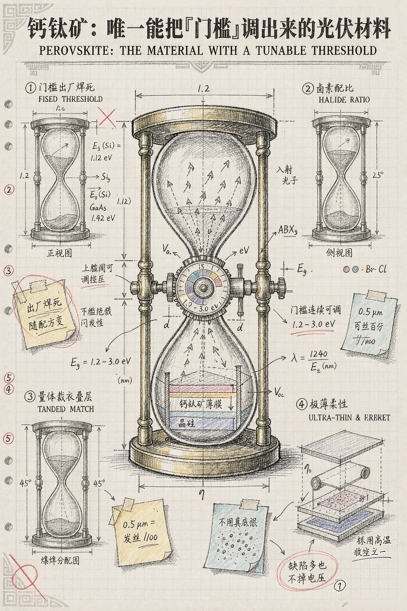
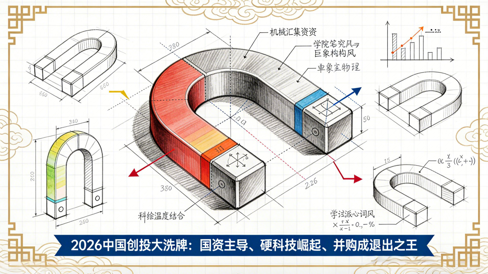
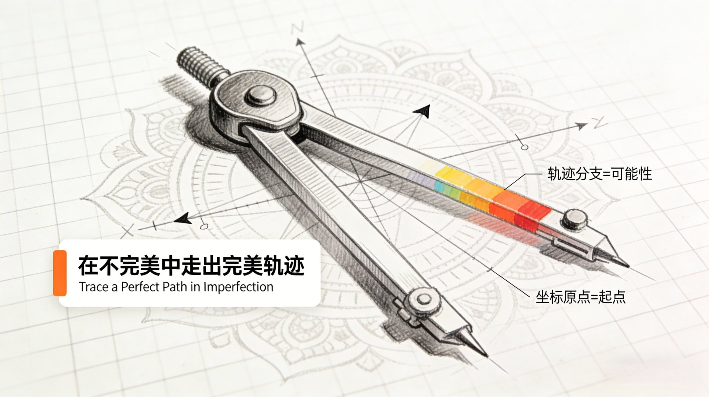
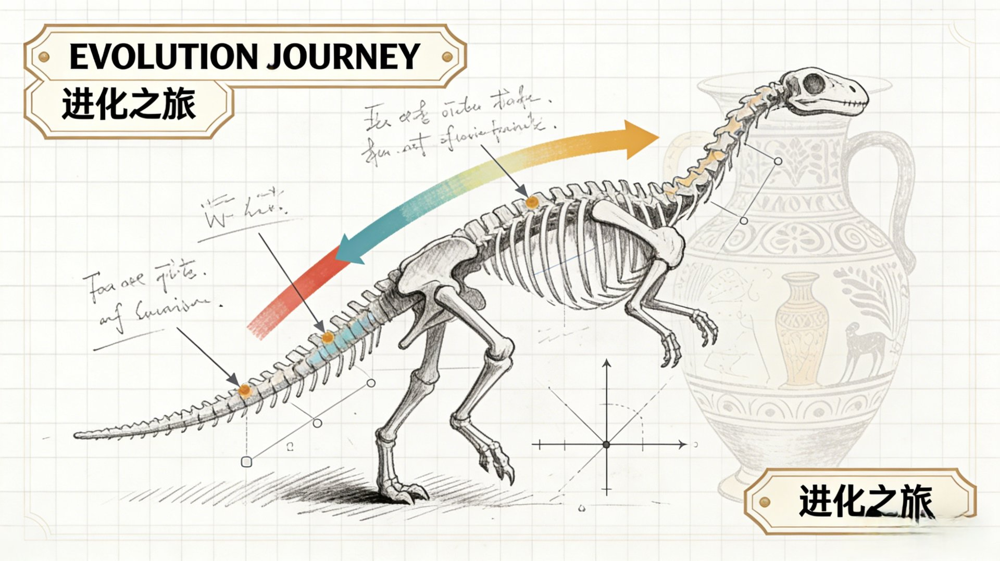
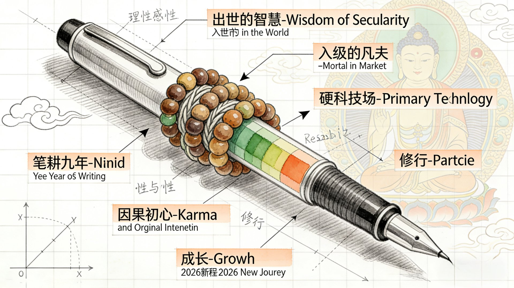
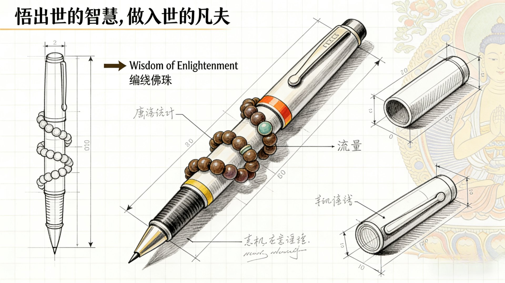
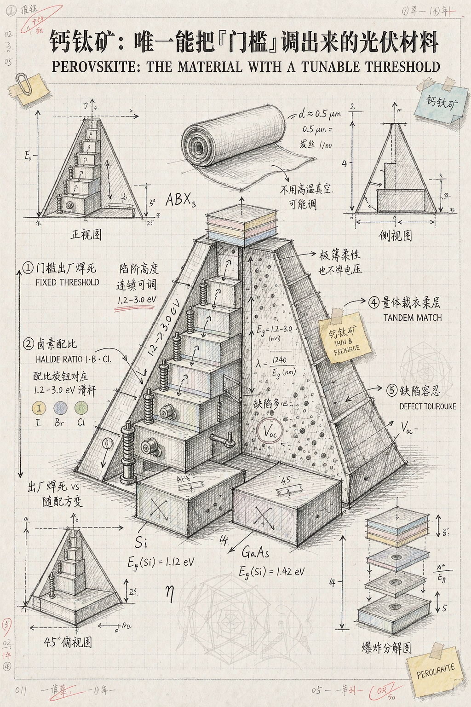

<div align="center">

## AIOpenVC · Open AI Toolkit for Investment

**Academic Visual-Notes Illustrator — AI Skill**

*Reshaping how primary-market information gets expressed, with AI · by Yijue*

[](./LICENSE)
[](https://github.com/one5ds/visual-notes-illustrator/stargazers)
[](./CONTRIBUTING.md)
[](./README.md)

⭐ **If this method helps you, hit Star in the top-right corner — it's the best support you can give.** ⭐

</div>

---

> Turn any paragraph into an academic, hand-drawn "visual notes" illustration — and get a precise, ready-to-paste image-generation prompt.

[简体中文 README →](./README.md) · [Example prompt →](./examples/perovskite-visual-note-prompt.md) · [Contributing →](./CONTRIBUTING.md)



---

## 1. The problem

Ask an AI to "illustrate this text" and you usually get a pretty image full of nothing: random elements, garbled text, little connection to the source.

This Skill turns text → illustration into a **controlled pipeline**: pick the canvas ratio first, decompose the argument structure second, **you personally choose the core subject** from 20 candidates third, and only then generate the prompt and the image. You sign off on the subject, so the output is the picture you actually wanted.

## 2. Five-step workflow

| Step | What happens | Output |
|---|---|---|
| ① Ratio | Choose 16:9 / 4:3 / 3:4 / 9:16 | Layout + pixel spec |
| ② Decompose | Central idea → title; sub-arguments → zones; concepts → bilingual labels | Structure breakdown table |
| ③ Subject | 20 subjects sampled from a 50-item pool, listed by number | One core subject |
| ④ Prompt | Fill the template → full version + 120-word compact version | Ready-to-use prompt |
| ⑤ Render | Generate the image; iterate on individual elements | Finished illustration |

## 3. Canvas specs

| Ratio | Pixels | Best for |
|---|---|---|
| 16:9 landscape | 1920×1080 | Blog headers, deck covers, widescreen |
| 4:3 landscape | 1184×888 | Classic lecture layout, embedded docs |
| 3:4 portrait | 896×1152 | Paper figures, notebook pages |
| 9:16 portrait | 1080×1920 | Mobile long-form, social posters |

## 4. Visual specification (the style skeleton)

- **Canvas**: white-dominant, faint 5 mm printed graph-paper grid, no dark background or dark borders
- **Line work**: crisp HB/2B graphite pencil drawing; shading by hatching and cross-hatching
- **Drafting elements**: dimension lines, arrows, coordinate axes, angle arcs, vectors, section symbols, numbered tags
- **Formulas**: 3–5 handwritten math / physics / chemistry / biology formulas relevant to the topic
- **Color**: grayscale base with low-saturation marker accents — **color coverage under 12%**
- **Handwritten notes**: 4–6 legible-but-scratchy annotations with underlines and circled marks
- **Academic texture**: sticky notes, paper clips, tape marks, punch holes, red correction marks, margin numbering
- **Hidden pattern**: one of Chinese fret / Greek vase / Arabic geometric / mandala / Andean textile / Persian miniature motif, as a very faint underlay
- **Text discipline**: printed bilingual labels only — no words unrelated to the source text

## 5. The 50-item subject pool (20 sampled each run)

Prism refraction tower, gear tree, neuron coral, floating compass, fission nucleus, double-helix staircase, hourglass engine, folded paper city, root network, honeycomb dome, crystal obelisk, origami bird, gear heart, onion-section sphere, fractal fern, lever balance, labyrinth slab, rising bubble tower, pendulum orbit, multistage rocket, crucible furnace, seed germination chamber, magnetic levitation gyro, creeping pipe body, puzzle cube, stepped pyramid, fiber-optic bouquet, swarm array, lock-and-key mechanism, lens eyeball, vortex funnel, shattered mask, arch bridge, windmill blades, tree-ring disc, folded map, vascular tree, ice crystal lattice, volcano section, gear compass, hatching egg, circuit-board mountain, pulley block, rippling water, stepped waterfall, nesting dolls, ballistic parabola, moon-phase disc, sundial gnomon, spiral galaxy disc

## 6. Install

```bash
# WorkBuddy (user level)
git clone https://github.com/one5ds/visual-notes-illustrator.git \
  ~/.workbuddy/skills/visual-notes-illustrator

# Claude Code (user level)
git clone https://github.com/one5ds/visual-notes-illustrator.git \
  ~/.claude/skills/visual-notes-illustrator
```

You can also just drop `SKILL.md` into your skills directory — the YAML frontmatter `name` / `description` drives auto-triggering. English users: rename `SKILL_EN.md` to `SKILL.md` first (the English copy ships without frontmatter so it won't double-register alongside the Chinese one).

## 7. Usage

```
Use the visual-notes-illustrator skill to turn this into a 9:16 portrait illustration:
<paste your text>
```

The Skill asks for the ratio, decomposes the structure, gives you 20 numbered subjects, you reply with a number, and it produces the prompt and the image.

## 8. Repository layout

```
visual-notes-illustrator/
├── SKILL.md                 # Skill definition (Chinese, with frontmatter — ready to use)
├── SKILL_EN.md              # English reference copy (no frontmatter; rename to SKILL.md to use)
├── README.md                # Chinese README
├── README_EN.md             # This file
├── LICENSE                  # MIT
├── CONTRIBUTING.md          # Contributing guide (subject-pool entries)
├── .gitignore
├── assets/
│   ├── perovskite-example.png    # Case A render (hourglass engine)
│   ├── perovskite-example-b.png  # Case B render (stepped pyramid)
│   └── gallery/
│       ├── vc-landscape-2026.png       # 2026 VC landscape reshuffle
│       ├── compass-imperfect-path.jpg  # Trace a perfect path in imperfection
│       ├── evolution-journey.jpg       # Evolution journey
│       ├── pen-wisdom-labels.jpg       # Pen & prayer beads — annotated concept
│       └── pen-wisdom-blueprint.jpg    # Pen & prayer beads — drafting sheet
└── examples/
    ├── perovskite-visual-note-prompt.md    # Case A prompt (hourglass engine)
    └── perovskite-visual-note-prompt-b.md # Case B prompt (stepped pyramid)
```

## 9. Gallery

One visual spec, different source texts → different core subjects, different hidden motifs. Each subject was chosen through the "pick 1 of 20" step.

<table>
  <tr>
    <td align="center" width="50%">
      <br>
      <sub><b>Perovskite: the material with a tunable threshold</b><br>Subject: hourglass engine · Motif: Chinese fret · 9:16</sub>
    </td>
    <td align="center" width="50%">
      <br>
      <sub><b>2026 China VC reshuffle: state capital leads, hard tech rises, M&amp;A rules exits</b><br>Subject: horseshoe magnet (magnetic field = capital gravity) · Motif: fret + auspicious clouds · 16:9</sub>
    </td>
  </tr>
  <tr>
    <td align="center" width="50%">
      <br>
      <sub><b>Trace a Perfect Path in Imperfection</b><br>Subject: drafting compass · Motif: mandala · landscape</sub>
    </td>
    <td align="center" width="50%">
      <br>
      <sub><b>EVOLUTION JOURNEY</b><br>Subject: dinosaur skeleton cutaway · Motif: Greek vase ornament · landscape</sub>
    </td>
  </tr>
  <tr>
    <td align="center" width="50%">
      <br>
      <sub><b>Wisdom of Enlightenment, Mortal in the Market (annotated concept)</b><br>Subject: fountain pen wrapped in prayer beads · Motif: mandala · 16:9</sub>
    </td>
    <td align="center" width="50%">
      <br>
      <sub><b>Wisdom of Enlightenment, Mortal in the Market (drafting sheet)</b><br>Subject: fountain pen with multi-view sketches and dimension callouts · 16:9</sub>
    </td>
  </tr>
</table>

> The same source text supports multiple iterations: the last row shows two render directions — an annotated concept sheet and a drafting sheet — for one theme.

### Same text, different subject = different picture (Case A / B)

Identical source text, title and information zones — only the core subject and hidden motif change:

<table>
  <tr>
    <td align="center" width="50%">
      <br>
      <sub><b>Case A · Hourglass Engine</b><br>Metaphor: photons filtered through an adjustable valve · Motif: Chinese fret</sub>
    </td>
    <td align="center" width="50%">
      <br>
      <sub><b>Case B · Stepped Pyramid</b><br>Metaphor: step height raised and lowered · Motif: Arabic geometric</sub>
    </td>
  </tr>
</table>

Full prompts: [Case A](./examples/perovskite-visual-note-prompt.md) · [Case B](./examples/perovskite-visual-note-prompt-b.md)

## 10. License

MIT © AIOpenVC
